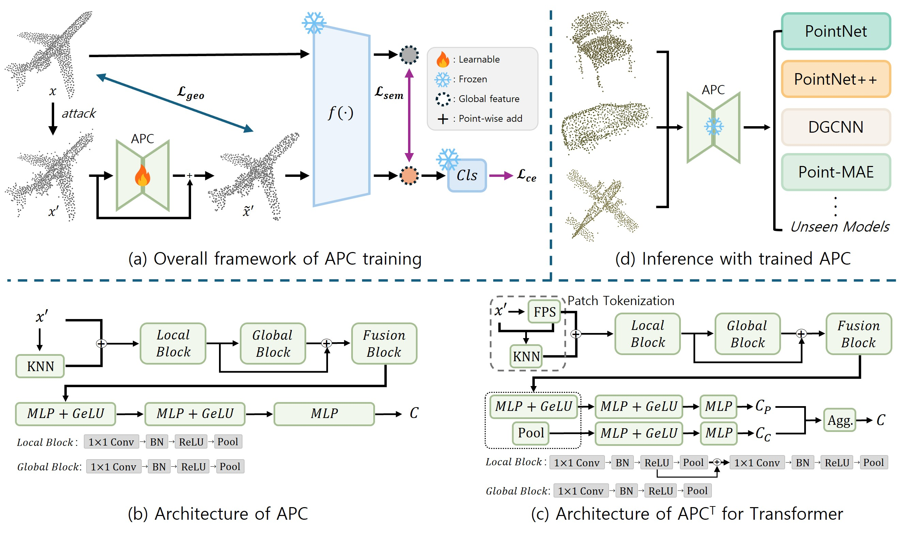

# Understanding and Generalizing Adversarial Purification for Robust 3D Point Cloud Recognition
<p align="center">

</p>

This repository provides the official implementation of  
"Understanding and Generalizing Adversarial Purification for Robust 3D Point Cloud Recognition"
> Geunyoung Jung and Jiyoung Jung  

## Abstract
> Deep neural networks have achieved substantial progress in 3D point cloud recognition, yet remain vulnerable to adversarial attacks. Despite efforts to develop defenses, existing approaches often face a trade-off between robustness and transferability. To address this limitation, we introduce Adversarial Point Counterattack (APC), a lightweight input-level purification module that generates instance-specific counter-perturbations. Trained on clean--adversarial pairs, APC enforces geometric and semantic consistency in the data and feature spaces, respectively. To enhance generalization across diverse attacks, we adopt a hybrid training strategy incorporating multiple attack types. We further investigate the underlying purification mechanism of APC and find that its counter-perturbations exhibit consistent patterns across different attacks rather than simply reversing adversarial perturbations. Motivated by this finding, we propose Attack-Free APC (AF-APC), which learns to purify point clouds using synthetic corruptions without requiring costly adversarial example generation. By operating directly on input point clouds, both methods transfer to unseen models and defend against attacks crafted for those models without retraining. Extensive experiments demonstrate that APC achieves state-of-the-art defense performance, while AF-APC maintains strong robustness. Cross-model evaluations further validate the transferability of both methods.

## Setup
```shell
git clone https://github.com/gyjung975/AF-APC.git
cd AF-APC

conda create -n af_apc python=3.8.16
conda activate af_apc

conda install pytorch==1.12.1 torchvision==0.13.1 torchaudio==0.12.1 cudatoolkit=11.3 -c pytorch
pip install Cython==0.29.21 tqdm==4.47.0 tensorboardX ipdb open3d seaborn wandb h5py torch-scatter trimesh

pip install --upgrade https://github.com/unlimblue/KNN_CUDA/releases/download/0.2/KNN_CUDA-0.2-py3-none-any.whl
pip install "git+https://github.com/facebookresearch/pytorch3d.git"
```

## Dataset
* Download datasets under `data/`.
```shell
data
 |── modelnet40_normal_resampled
 |── ScanObjectNN
```

## Train victim models
```shell
python train.py --model pointnet --dataset mn40
```

## Genertate adversarial point clouds
* Only required for **APC**
```shell
python attack_scripts/add.py --model pointnet --dataset mn40
```

## Train
```shell
# APC
python main.py --model pointnet --dataset mn40 --attack_type knn hit drop
# AF-ACP
python af_main.py --model pointnet --dataset mn40 --attack_type synth
```

## Eval
```shell
# APC
python eval.py --apc_model pointnet --model pointnet --dataset mn40 --attack_type knn hit drop --attack_type_eval all
# AF-APC
python eval.py --apc_model pointnet --model pointnet --dataset mn40 --attack_type synth --attack_type_eval all
```

## Acknowledgements
Our codes are built upon [Benchmark](https://github.com/qiufan319/benchmark_pc_attack). Thanks for their efforts.
